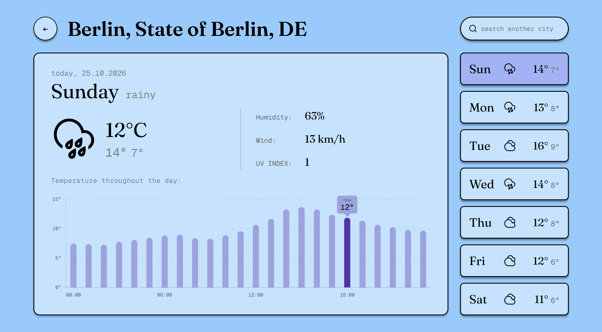

# Weather Forecast

A weather app with city search, current conditions, an hourly temperature chart and a 7-day forecast. The colours change with the weather. Built with vanilla HTML, CSS and JavaScript, with no framework, no build step and no API key.

**Live demo:** https://thienmyyy.github.io/Weather-Forecast/



## Features
- City search with autocomplete, keyboard navigation (↑ ↓ Enter Esc) and a "No cities found" state
- Current temperature, humidity, wind and UV index
- Interactive hourly temperature chart with a custom tooltip (hover or click to pin). Its default tooltip shows the live temperature at the current hour, labelled "now"
- 7-day forecast sidebar; click a day to see its details and hourly chart
- Theme colours per weather type (sunny, cloudy, rainy, snowy, stormy)
- Responsive layout and keyboard-accessible controls

## Tech
- HTML, CSS, JavaScript (no framework)
- [Chart.js](https://www.chartjs.org/) for the hourly chart
- [Open-Meteo](https://open-meteo.com/) for city search (geocoding), current weather and the forecast. It needs no API key.

## Run it locally
1. Clone the repo.
2. Serve the folder (opening the files directly can hit CORS issues):
   ```
   python -m http.server 8080
   ```
3. Open http://localhost:8080/

## How it works
- `index.html` is the landing page where you type a city. `weather.html` shows the forecast.
- `shared.js` holds code used by both pages: geocoding, the suggestions list, keyboard handling and toasts.
- `app.js` fetches the forecast and renders the cards and the chart.
- **Stale responses are ignored.** Every weather request and every search gets a number from a counter. When a response arrives, it is dropped if a newer request has started since, so a slow answer for an old city can never overwrite the one you picked last.

## Project history
The app started with OpenWeatherMap for the city search and current weather. When I added the hourly chart and the 7-day forecast, OpenWeatherMap's free current-weather endpoint didn't provide that data, so I added Open-Meteo for it and the app used two APIs for a while.

That setup had two downsides. The OpenWeatherMap API key had to live in client-side JavaScript, where anyone can read it in the browser, and the two services could disagree about the current conditions. I kept the key out of the repository with a gitignored `config.js`, but a client-side app can't truly hide a key without a backend. In the end I moved everything to Open-Meteo, which needs no key. That removed the secret, one network request per search and the setup step for anyone running the project.

## Known limitations
- The free Open-Meteo API is for non-commercial use and has daily request limits.
- Search results are limited to towns and cities (countries, islands and glaciers are filtered out), so searching "Germany" returns places named Germany rather than the country.
- The big current temperature is a live reading that updates every 15 minutes, while the chart shows one value per full hour, so the two can differ by a degree or so. The chart tooltip labels the live value as "now".
- Data is loaded once per search and doesn't refresh by itself, so reload the page to get the latest reading.
- Temperatures are in °C and dates in `dd.mm.yyyy`.

## Design
I designed the UI in Figma before building it: [Figma file](https://www.figma.com/design/HtxlF617OrHCrqnb2cHyoi/weather-forecast?node-id=0-1&p=f&t=SsF8WuMlocXRt5Br-0)

## Credits
- Weather data and geocoding by [Open-Meteo.com](https://open-meteo.com/) ([CC BY 4.0](https://creativecommons.org/licenses/by/4.0/))
- Weather icons from [Weather Icons Kit (Community)](https://www.figma.com/design/hOELQvYMiTLraGPkqa1l9h/Weather--Icons-Kit--Community-?node-id=9-2362&t=PNEPnP40V64Kukmx-1) by Leya Cherkasova, licensed [CC BY 4.0](https://creativecommons.org/licenses/by/4.0/)
- Fonts from Google Fonts: Albert Sans, Fraunces and Geist Mono

## What I learned
- Async/await and error handling across several API calls
- Guarding against stale responses when requests overlap
- Debouncing user input and building an accessible autocomplete
- Rendering and customising charts with Chart.js
- Why client-side apps can't keep API keys secret, and simplifying the architecture to avoid needing one

## License
MIT
